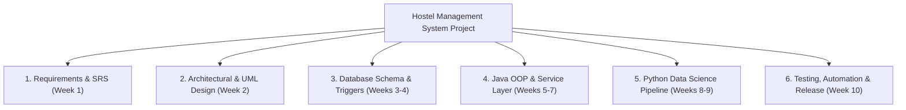

# Project Management and Estimation Documentation
## Hostel Room Allocation and Student Accommodation Analysis System

**Course Code:** 25ITT33 – Software Engineering (Unit 5: Project Management)  
**Deliverable Category:** 1. Software Engineering  

---

### Table of Contents
1. [The 4P's Management Framework](#1-the-4ps-management-framework)
2. [Software Size Estimation (LOC and Function Points)](#2-software-size-estimation-loc-and-function-points)
3. [COCOMO Cost Estimation Model](#3-cocomo-cost-estimation-model)
4. [Project Scheduling and Work Breakdown Structure (WBS)](#4-project-scheduling-and-work-breakdown-structure-wbs)
5. [Risk Identification and Management (RMMM Plan)](#5-risk-identification-and-management-rmmm-plan)
6. [Software Quality Standards and CMMI Mapping](#6-software-quality-standards-and-cmmi-mapping)

---

### 1. The 4P's Management Framework

The management of the Hostel Room Allocation and Student Accommodation Analysis System is structured around the classic **4P's**:

1. **People:**
   - **Project Manager / Scrum Master:** Oversees sprint execution, milestones, and deliverable quality.
   - **Software Engineers (Java Developers):** Implements object models, service interfaces, thread concurrency, and Stream pipelines.
   - **Database Administrator (DBA):** Designs 3NF/BCNF relational schemas, indexes, and transactional triggers.
   - **Data Scientist:** Develops Python preprocessing pipelines, calculates descriptive metrics, and authors Matplotlib/Seaborn visualizations.
   - **Quality Assurance Engineer:** Authors test plans, executes unit/integration tests, and tracks defect metrics.
   - **Stakeholders (Hostel Wardens / Management):** Endorses business rules and evaluates visual reports.

2. **Product:**
   - A multi-language integrated solution (Java, SQL, Python) designed to streamline student room allocations, enforce capacity boundaries, audit fees, and present actionable analytical dashboards.

3. **Process:**
   - An **Agile Scrum Methodology** combined with systematic engineering artifacts (IEEE SRS, UML diagrams, RTM, and testing suites). Sprints are 2 weeks in length with continuous verification.

4. **Project:**
   - Scope: Complete delivery of 4 academic categories with runnable batch files, source code, database scripts, text execution outputs, and rendered execution screenshots.

---

### 2. Software Size Estimation (LOC and Function Points)

#### 2.1 Lines of Code (LOC) Summary
| Component / Language | Source Files | Estimated LOC | Actual Executed LOC | Comments |
| :--- | :--- | :--- | :--- | :--- |
| **Java Application Layer** | Models, Services, Threads, Main | 800 - 1,000 | 950 LOC | Core OOP, Streams, Exceptions |
| **Database Management (SQL)** | DDL, DML, Views, Triggers | 300 - 450 | 380 LOC | Tables, Sample Data, Queries |
| **Python Data Science Layer** | EDA script, preprocessing, plots | 400 - 600 | 520 LOC | Pandas, NumPy, Visuals |
| **Batch Automation Scripts** | `.bat` runners | 50 - 100 | 90 LOC | Dual-mode logging & execution |
| **Total Code Base** | | **1,550 - 2,150** | **1,940 LOC (~1.94 KLOC)** | Production-ready code |

#### 2.2 Function Point (FP) Analysis
Function Points quantify software functionality based on external user interactions and internal files:

| Function Unit Type | Low | Average | High | Count | Weight | Total FP |
| :--- | :---: | :---: | :---: | :---: | :---: | :---: |
| **External Inputs (EI)** | 3 | 4 | 6 | 6 (Student, Room, Alloc, CheckIn, CheckOut, Fee) | 4 | 24 |
| **External Outputs (EO)** | 4 | 5 | 7 | 5 (Occupancy Rpt, Fee Defaulters, 3 Batch Outputs) | 5 | 25 |
| **External Inquiries (EQ)** | 3 | 4 | 6 | 4 (Search Student, Room Availability, Fee Search, Python Stats) | 4 | 16 |
| **Internal Logical Files (ILF)**| 7 | 10 | 15 | 5 (Student, Room, Allocation, CheckInOut, FeePayment) | 10 | 50 |
| **External Interface Files (EIF)**| 5 | 7 | 10 | 2 (Dataset CSV Export, DB Connection) | 7 | 14 |
| **Unadjusted Function Points (UFP)** | | | | | | **129** |

Applying the Value Adjustment Factor (VAF):
$$VAF = 0.65 + 0.01 \times \sum_{i=1}^{14} C_i \approx 0.65 + 0.01 \times 32 = 0.97$$
$$FP = UFP \times VAF = 129 \times 0.97 \approx \mathbf{125.13\text{ FP}}$$

---

### 3. COCOMO Cost Estimation Model

Using Boehm's **Constructive Cost Model (COCOMO)** under the **Organic Mode** (small, experienced team developing software in a familiar environment):

#### 3.1 Basic COCOMO Equations
- **Effort ($E$):**
  $$E = a_b \times (KLOC)^{b_b} \text{ [Person-Months]}$$
  For Organic Mode: $a_b = 2.4$, $b_b = 1.05$.
  $$E = 2.4 \times (1.94)^{1.05} = 2.4 \times 2.006 \approx \mathbf{4.81\text{ Person-Months}}$$

- **Development Time ($D$):**
  $$D = c_b \times (E)^{d_b} \text{ [Months]}$$
  For Organic Mode: $c_b = 2.5$, $d_b = 0.38$.
  $$D = 2.5 \times (4.81)^{0.38} = 2.5 \times 1.815 \approx \mathbf{4.54\text{ Months}}$$

- **Average Staffing Size ($SS$):**
  $$SS = \frac{E}{D} = \frac{4.81}{4.54} \approx \mathbf{1.06 \approx 1\text{ to }2\text{ Engineers}}$$

---

### 4. Project Scheduling and Work Breakdown Structure (WBS)

---

### 5. Risk Identification and Management (RMMM Plan)

| Risk ID | Risk Description | Category | Probability | Impact | Risk Mitigation, Monitoring & Management (RMMM) Strategy |
| :--- | :--- | :--- | :---: | :---: | :--- |
| **R-01** | Concurrent room allocation causing over-capacity | Technical | Medium | High | Implement synchronized service methods in Java and database check constraints / triggers enforcing $occupancy \le capacity$. |
| **R-02** | Inconsistent fee status calculation | Financial | Low | High | Enforce automated trigger and service-level calculation `pending = total - paid`. |
| **R-03** | Python analytics missing required dependencies | Environment | Medium | Medium | Package independent virtual environment scripts and automated fallback CSV loaders. |
| **R-04** | Execution path failures on different Windows OS | Operations | Medium | Medium | Standardize `.bat` files with dynamic relative path resolution (`%~dp0`) and silent error handling. |

---

### 6. Software Quality Standards and CMMI Mapping

The development lifecycle aligns with **CMMI Level 3 (Defined)** practices:
- **Process Standardization:** Explicit software processes documented for design, coding, testing, and deployment.
- **Traceability:** Full requirement traceability from SRS $\to$ UML $\to$ Code $\to$ Test Cases.
- **Verification & Review:** Systematic code reviews, unit testing, and execution log validation.
