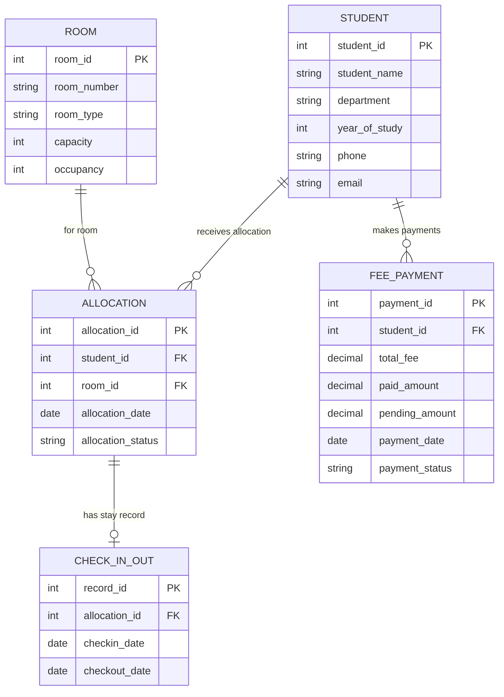

# Relational Data Model and Schema Documentation
## Hostel Room Allocation and Student Accommodation Analysis System

**Course Code:** 25ITT31 – Database Management Systems (Unit 1: Database Systems and Design)  
**Deliverable Category:** 2. Database Management System  

---

### Table of Contents
1. [Entity-Relationship (ER) Overview](#1-entity-relationship-er-overview)
2. [Mapping Cardinalities and Business Rules](#2-mapping-cardinalities-and-business-rules)
3. [Relational Schema and Notation](#3-relational-schema-and-notation)
4. [Integrity Constraints](#4-integrity-constraints)
5. [Relational Algebra Queries](#5-relational-algebra-queries)

---

### 1. Entity-Relationship (ER) Overview

The Entity-Relationship model structures the hostel domain into five primary entities interconnected via clear semantic associations.

> **Diagram Image:** [er_diagram.jpg](file:///D:/HostelManagementSystem/2_database_management_system/er_diagram.jpg)

---

### 2. Mapping Cardinalities and Business Rules

1. **STUDENT to ALLOCATION ($1 : N$):**
   - A student can have multiple allocation records over time (e.g. across multiple academic years).
   - **Critical Business Rule:** Only **ONE active allocation** (`allocation_status = 'ALLOCATED'`) is permitted per student at any given time.
2. **ROOM to ALLOCATION ($1 : N$):**
   - A room may appear in multiple allocation records across its lifetime.
   - **Critical Business Rule:** Current active allocations (`occupancy`) must never exceed the room's physical `capacity` ($0 \le occupancy \le capacity$).
3. **ALLOCATION to CHECK_IN_OUT ($1 : 0..1$):**
   - Each allocation record can link to at most one physical check-in and check-out stay record.
4. **STUDENT to FEE_PAYMENT ($1 : N$):**
   - Each payment belongs to exactly one student. A student may make multiple payments or installment settlements.

---

### 3. Relational Schema and Notation

The conceptual ER model maps to the following relational schemas (Primary Keys are underlined $\underline{\text{PK}}$, Foreign Keys are denoted with an asterisk $*$):

1. **STUDENT** ($\underline{student\_id}$, $student\_name$, $department$, $year\_of\_study$, $phone$, $email$)
   - Primary Key: `student_id`
   - Alternate Key / Unique: `email`, `phone`

2. **ROOM** ($\underline{room\_id}$, $room\_number$, $room\_type$, $capacity$, $occupancy$)
   - Primary Key: `room_id`
   - Alternate Key / Unique: `room_number`

3. **ALLOCATION** ($\underline{allocation\_id}$, $student\_id^*$, $room\_id^*$, $allocation\_date$, $allocation\_status$)
   - Primary Key: `allocation_id`
   - Foreign Key 1: `student_id` references `STUDENT(student_id)` on delete cascade
   - Foreign Key 2: `room_id` references `ROOM(room_id)` on delete restrict

4. **CHECK_IN_OUT** ($\underline{record\_id}$, $allocation\_id^*$, $checkin\_date$, $checkout\_date$)
   - Primary Key: `record_id`
   - Foreign Key: `allocation_id` references `ALLOCATION(allocation_id)` on delete cascade

5. **FEE_PAYMENT** ($\underline{payment\_id}$, $student\_id^*$, $total\_fee$, $paid\_amount$, $pending\_amount$, $payment\_date$, $payment\_status$)
   - Primary Key: `payment_id`
   - Foreign Key: `student_id` references `STUDENT(student_id)` on delete cascade

---

### 4. Integrity Constraints

- **Domain Constraints:**
  - $year\_of\_study \in \{1, 2, 3, 4\}$
  - $room\_type \in \{\text{'Single AC'}, \text{'Double Non-AC'}, \text{'Triple Non-AC'}\}$
  - $allocation\_status \in \{\text{'ALLOCATED'}, \text{'RELEASED'}, \text{'CANCELLED'}\}$
  - $payment\_status \in \{\text{'PAID'}, \text{'PARTIAL'}, \text{'PENDING'}\}$
- **Entity Integrity:**
  - In all relations, the primary key attributes cannot contain `NULL` values.
- **Referential Integrity:**
  - Every non-null foreign key in `ALLOCATION`, `CHECK_IN_OUT`, and `FEE_PAYMENT` must match an existing primary key in the referenced parent relation.
- **Check Constraints:**
  - `CHECK (capacity > 0 AND capacity <= 5)`
  - `CHECK (occupancy >= 0 AND occupancy <= capacity)`
  - `CHECK (paid_amount >= 0 AND paid_amount <= total_fee)`
  - `CHECK (pending_amount = total_fee - paid_amount)`

---

### 5. Relational Algebra Queries

#### 5.1 Query 1: Find all 3rd Year students in the 'CSE' Department (Selection & Projection)
$$\pi_{student\_id, student\_name, phone} (\sigma_{department = 'CSE' \land year\_of\_study = 3} (STUDENT))$$

#### 5.2 Query 2: Retrieve all rooms that have available beds (Selection & Computed Attribute)
$$\sigma_{occupancy < capacity} (ROOM)$$

#### 5.3 Query 3: List Student Name, Room Number, and Room Type for all active allocations (Natural Join)
$$\pi_{student\_name, room\_number, room\_type} (\sigma_{allocation\_status = 'ALLOCATED'} (STUDENT \bowtie ALLOCATION \bowtie ROOM))$$

#### 5.4 Query 4: Find total pending fees across all hostellers (Aggregate Function $\mathcal{G}$)
$$\mathcal{G}_{SUM(pending\_amount)} (FEE\_PAYMENT)$$

#### 5.5 Query 5: Find students who have pending fees greater than ₹10,000
$$\pi_{student\_id, student\_name, pending\_amount} (STUDENT \bowtie \sigma_{pending\_amount > 10000} (FEE\_PAYMENT))$$
