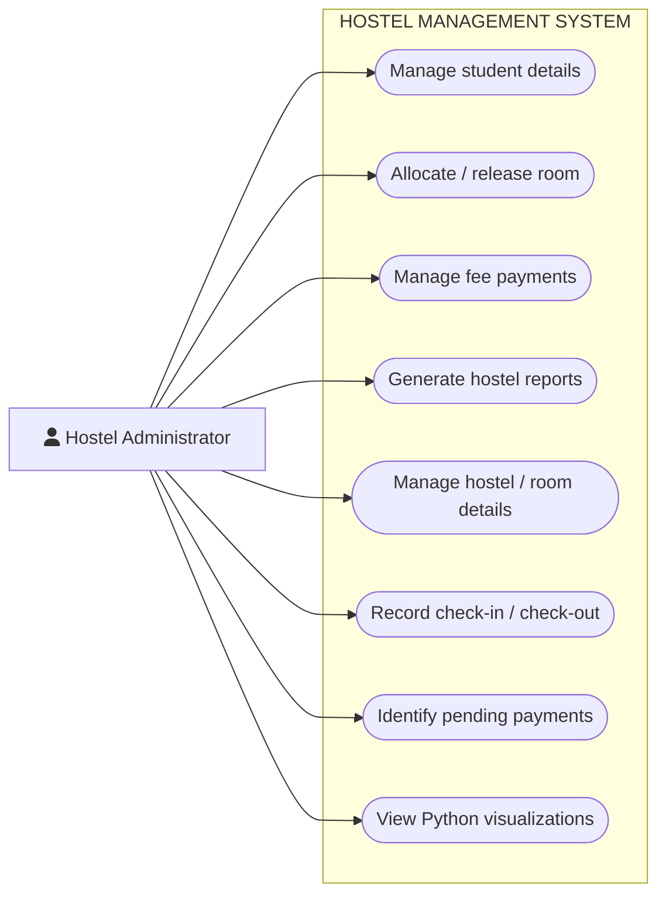
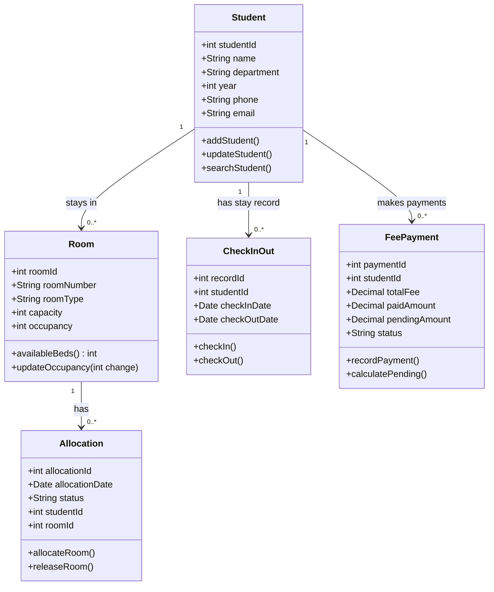
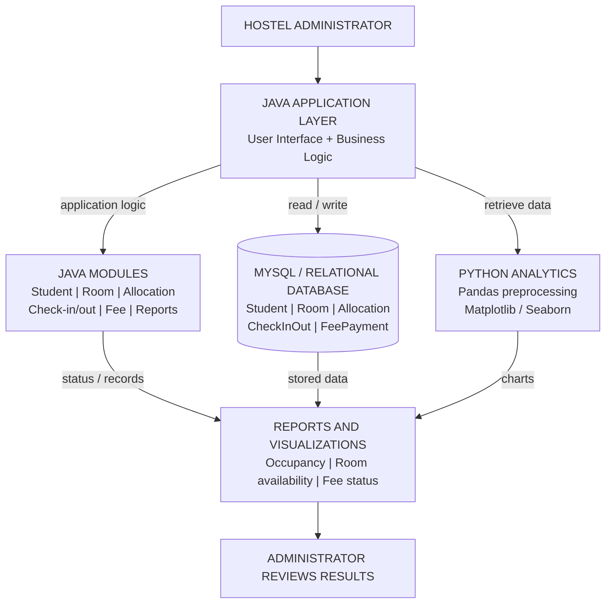
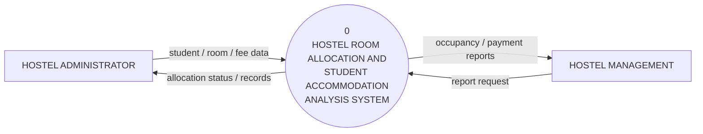
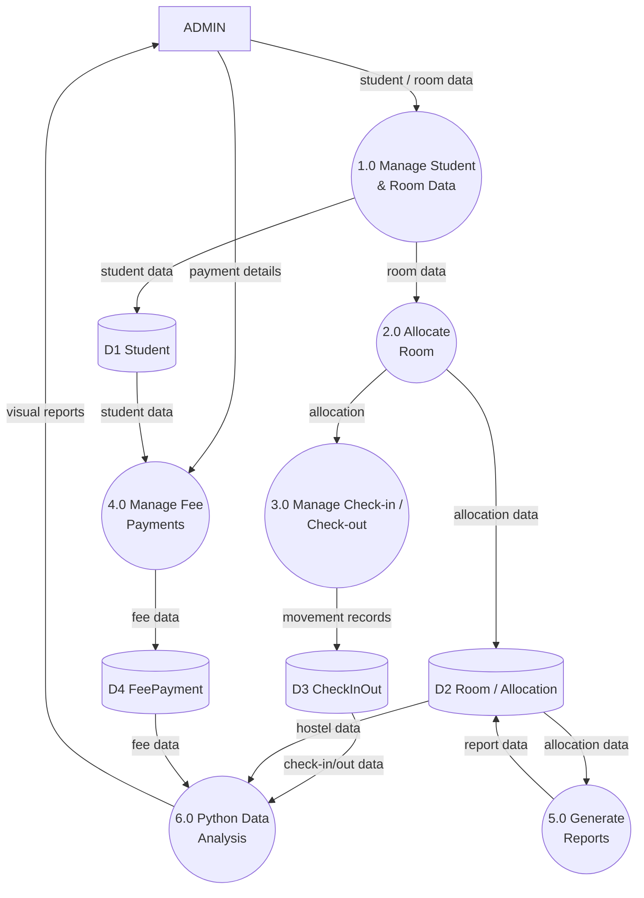
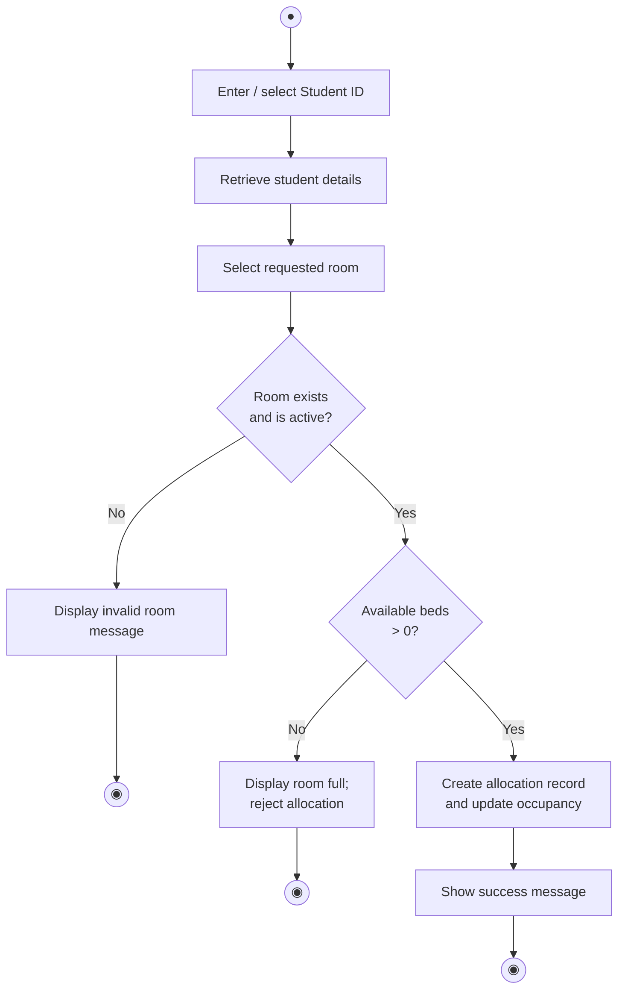
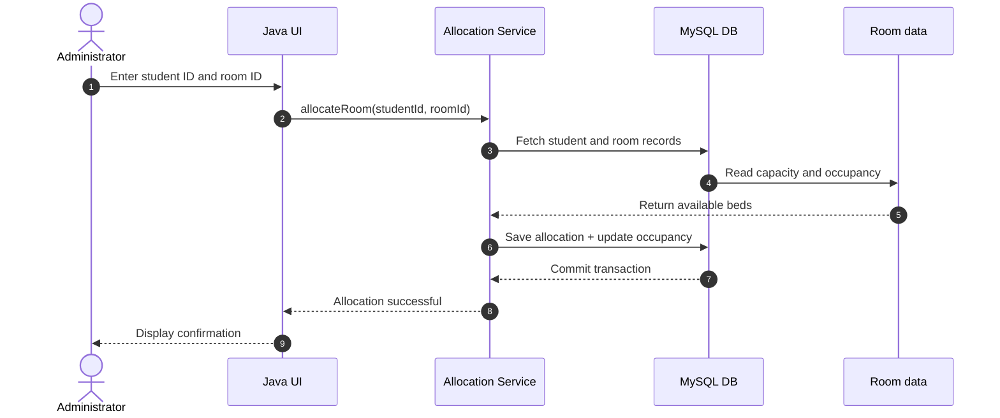

# System Design and Architecture Documentation
## Hostel Room Allocation and Student Accommodation Analysis System

**Course Code:** 25ITT33 – Software Engineering (Units 2 & 3: Requirements & Software Design)  
**Deliverable Category:** 1. Software Engineering  

---

### Table of Contents
1. [Architectural Overview](#1-architectural-overview)
2. [1. Use Case Diagram](#2-1-use-case-diagram)
3. [2. Class Diagram](#3-2-class-diagram)
4. [3. System Architecture Diagram](#4-3-system-architecture-diagram)
5. [4. Data Flow Diagram – Level 0 (Context Diagram)](#5-4-data-flow-diagram--level-0-context-diagram)
6. [5. Data Flow Diagram – Level 1](#6-5-data-flow-diagram--level-1)
7. [6. Activity Diagram (Room Allocation with Capacity Validation)](#7-6-activity-diagram)
8. [7. Sequence Diagram (Successful Room Allocation Flow)](#8-7-sequence-diagram)
9. [Design Patterns and Principles Applied](#9-design-patterns-and-principles-applied)

---

### 1. Architectural Overview

The Hostel Room Allocation and Student Accommodation Analysis System adopts a decoupled **3-Tier Component Architecture** structured across:
1. **User Presentation & Application Layer (Java SE):** Console administrative dashboard, domain models, business logic services, multi-threaded task runners, and Stream API reporting.
2. **Enterprise Data Persistence Layer (DBMS):** Relational schema, referential integrity constraints, automated triggers for capacity updates, stored views, and ACID transaction boundaries.
3. **Analytics and Visual Insight Layer (Python Data Science):** Statistical preprocessing, NumPy vectorization, Pandas grouping/pivoting, and Matplotlib/Seaborn visual renderers.

---

### 2. 1. Use Case Diagram

The Use Case Diagram defines the behavioral boundaries of the Hostel Management System and illustrates interactions between the primary actor (**Hostel Administrator**) and the core functional capabilities.

> **Diagram Image:** [use_case_diagram.jpg](file:///D:/HostelManagementSystem/1_software_engineering/use_case_diagram.jpg)

#### Actor and Use Case Specification:
- **Hostel Administrator:** Primary operational actor authorized to manage student registries, room inventories, room allocations, check-ins/outs, and payment audits.
- **UC-1 Manage Student Details:** Allows creating, updating, searching, and viewing student profiles.
- **UC-2 Allocate / Release Room:** Performs bed allocation verifying available capacity, and deallocates rooms upon student exit.
- **UC-3 Manage Fee Payments:** Records fee receipts, calculating pending amounts.
- **UC-4 Generate Hostel Reports:** Produces room occupancy, availability, and financial summaries.
- **UC-5 Manage Hostel / Room Details:** Configures room inventory, room types, and bed capacities.
- **UC-6 Record Check-in / Check-out:** Tracks physical dates of arrival and departure.
- **UC-7 Identify Pending Payments:** Filters records where `pendingAmount > 0`.
- **UC-8 View Python Visualizations:** Launches data science scripts to examine graphical occupancy and fee distribution plots.

---

### 3. 2. Class Diagram

The Class Diagram depicts the object-oriented structure of the domain model, capturing core classes, attributes, access visibility modifiers (`+` public, `-` private), methods, and structural associations with multiplicities.

> **Diagram Image:** [class_diagram.jpg](file:///D:/HostelManagementSystem/1_software_engineering/class_diagram.jpg)

#### Multiplicity and Structural Rules:
- **Student to Allocation (`1` to `0..*`):** A student can have multiple allocation records historically, but at most **ONE active allocation** at any given time.
- **Room to Allocation (`1` to `0..*`):** A room can be allocated to multiple students over time, provided current `occupancy <= capacity`.
- **Student to CheckInOut (`1` to `0..*`):** A student accumulates check-in/out records representing physical stays.
- **Student to FeePayment (`1` to `0..*`):** A student may pay semester fees in multiple installments.

---

### 4. 3. System Architecture Diagram

The System Architecture Diagram illustrates the tiered organization of the software, highlighting communication flows between user actors, application logic, database storage, and analytical pipelines.

> **Diagram Image:** [system_architecture_diagram.jpg](file:///D:/HostelManagementSystem/1_software_engineering/system_architecture_diagram.jpg)

#### Architectural Tiers:
1. **Hostel Administrator Interface:** Initiates commands via CLI or batch scripts.
2. **Java Application Layer:** Hosts core domain business logic, handles input validation, executes Stream pipelines, and initiates asynchronous multi-threaded jobs.
3. **Database Layer:** Maintains relational tables (`STUDENT`, `ROOM`, `ALLOCATION`, `CHECK_IN_OUT`, `FEE_PAYMENT`), enforces constraints and triggers.
4. **Python Analytics Layer:** Preprocesses dataset, performs descriptive statistical calculations, detects outliers with z-scores, and generates 7 distinct high-resolution charts.
5. **Report & Visualization Output:** Aggregates console reports, text exports, and visual charts for review by hostel authorities.

---

### 5. 4. Data Flow Diagram – Level 0 (Context Diagram)

The Level-0 Context Diagram establishes the global information boundary, showing the entire system as a single process interacting with external entities.

> **Diagram Image:** [dfd_level_0.jpg](file:///D:/HostelManagementSystem/1_software_engineering/dfd_level_0.jpg)

#### Data Flows:
- **Admin to System:** Student profiles, room details, room allocation requests, check-in/out entries, fee transactions.
- **System to Admin:** Allocation status, validation confirmations, receipt vouchers, search records.
- **Management to System:** High-level requests for room availability, capacity utilization, and fee arrears audits.
- **System to Management:** Room occupancy dashboards, revenue reports, and Python graphical visualizations.

---

### 6. 5. Data Flow Diagram – Level 1

The Level-1 Data Flow Diagram decomposes Process 0 into its constituent functional processes and links them to underlying relational data stores.

> **Diagram Image:** [dfd_level_1.jpg](file:///D:/HostelManagementSystem/1_software_engineering/dfd_level_1.jpg)

---

### 7. 6. Activity Diagram

The Activity Diagram models the decision logic executed during a room allocation request, highlighting strict capacity validation rules that prevent over-allocation.

> **Diagram Image:** [activity_diagram.jpg](file:///D:/HostelManagementSystem/1_software_engineering/activity_diagram.jpg)

#### Key Decision Gates:
1. **Room Validity Gate:** Ensures the requested room exists in the inventory.
2. **Bed Availability Gate (`availableBeds > 0`):** Compares current `occupancy` with `capacity`. If `occupancy >= capacity`, the request is immediately rejected, guaranteeing that over-allocation cannot occur.

---

### 8. 7. Sequence Diagram

The Sequence Diagram captures the chronological message exchange between participating objects during a successful room allocation transaction.

> **Diagram Image:** [sequence_diagram.jpg](file:///D:/HostelManagementSystem/1_software_engineering/sequence_diagram.jpg)

---

### 9. Design Patterns and Principles Applied

1. **Model-View-Controller / Service-Oriented Layering:** Clear separation of concerns between domain entities (`model`), business logic (`service`), exception management (`exception`), and user presentation (`Main`).
2. **Data Access Object (DAO) / Repository Pattern:** Encapsulates persistence interactions, allowing seamless swapping between in-memory collections, SQLite, and MySQL.
3. **Fail-Fast Validation & Custom Exceptions:** Capacity and duplicate allocation rules fail immediately with descriptive checked exceptions (`RoomCapacityExceededException`, `StudentAlreadyAllocatedException`).
4. **Observer / Asynchronous Worker Pattern:** Report generation is dispatched to dedicated worker threads (`OccupancyReportWorker`, `FeeAuditorWorker`), ensuring responsiveness.
